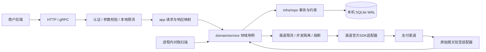
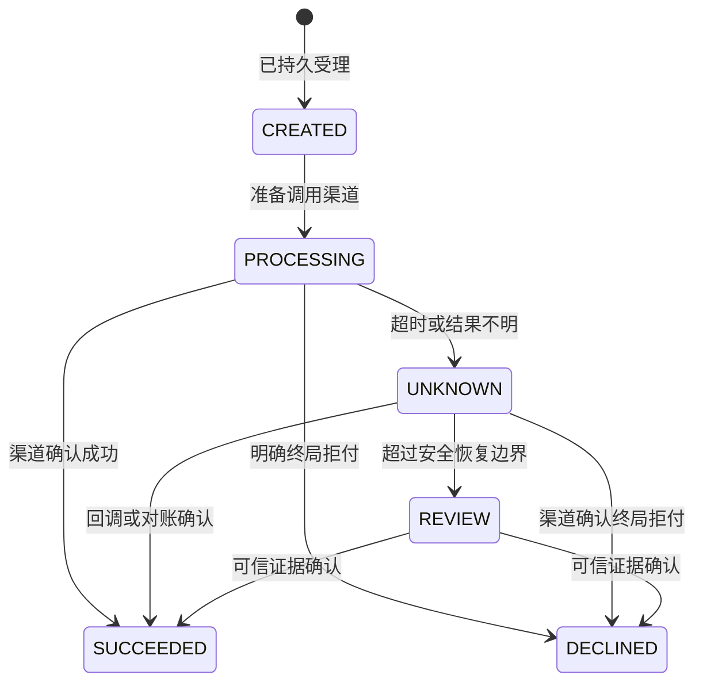

# 支付 / 订单服务架构设计（Fino + SQLite）

本次交付为架构与 proto 契约，尚未生成或实现后端。`proto/` 是 API 唯一事实来源；本文描述领域规则、SQLite 事务和后续实现要求。

## 1. 服务边界与部署

保留一个 `OrderpayService`，对应 `orderpay-server`。订单、支付、对账和审计是同一业务边界内的模块，不按 RPC 拆微服务。采用 Go + Fino，SQLite 保存全部业务事实；不引入 Redis、消息中间件或外部任务队列。

面向已认证的商户后端，由商户完成商品定价。本期仅 CNY、整数分、全额支付，每笔订单只允许一笔支付记录。拒付后可取消订单，重新购买创建新订单。退款、库存、分账、账务分录和完整收银台交互另行设计。

部署为**单机单活动进程**，HTTP/gRPC 与对账调度在同一进程，数据库位于本机持久卷。WAL 允许读写并行，但同时只有一个写事务，不支持将数据库文件放到网络文件系统供多主机共享。[SQLite WAL 官方说明](https://sqlite.org/wal.html)

## 2. Fino 文件归属与分层

| 位置 | 职责 |
| --- | --- |
| `proto/orderpay/*.proto` | 持久化模型、共享状态枚举及数据库字段元数据 |
| `proto/orderpay/v1/orderpay.proto` | 服务、HTTP 绑定、Request/Response、Input/View及请求校验 |
| `backend/modules/orderpay-server/app/` | 鉴权作用域、DTO映射、响应组合与业务错误映射 |
| `domain/service/` | 幂等、订单状态、支付提交、确认和对账规则 |
| `domain/repo/`、`infra/repo/` | 狭窄仓储端口、SQLite短事务、约束与查询 |
| `backend/cmd/orderpay-server/` | 后续依赖装配与进程内调度生命周期 |

不直接将持久化模型作为 API 载荷，不开放通用修改支付状态、金额或审计记录的 CRUD。模型字段含 `(fino.db).comment`，请求校验使用 `(fino.validate)`。服务端生成 UUIDv7；时间字段使用 `fino.core.Timestamp`，创建/更新时间固定为98/99。

当前 `fino.yaml` 的数据库仍为空。本次不修改配置；后续实现阶段需显式将 `backend.orderpay-server.infra.database` 设为 `sqlite`，配置连接参数并完成迁移。本次不运行生成器，不手改生成文件、IR、OpenAPI或代码。

## 3. SQLite 事务与运行约束

建议参数为 `journal_mode=WAL`、`synchronous=FULL`、`foreign_keys=ON`、`busy_timeout=1000`；后两项及同步级别应确保每个相关连接生效。FULL 在 WAL 提交时增加同步操作，用于提高掉电时的持久性；实际效果仍依赖存储设备。[SQLite PRAGMA](https://sqlite.org/pragma.html)

写连接池限制为1，读池小规模独立配置，禁止嵌套使用另一连接执行同一用例的写入。创建支付、取消订单及支付确认使用短事务，在同一专用连接执行 `BEGIN IMMEDIATE`，尽早取得写锁；SQLite不使用 `SELECT FOR UPDATE`。锁等待失败按可重试依赖故障处理，不将其误报为业务冲突。[SQLite 事务说明](https://sqlite.org/lang_transaction.html)

远端调用在事务外执行。事务期间重新读取状态，不能仅依赖调用前的内存判断。数据库持久状态和唯一约束保证正确性，进程内互斥只减少竞争。

## 4. 模型与必须落实的约束

| 模型 | 用途 | 迁移必须落实的约束 |
| --- | --- | --- |
| `Order` | 商户业务订单、金额、生命周期 | 唯一 `(merchant_id, merchant_order_no)`；金额1至100000000分；币种CNY |
| `Payment` | 唯一支付、渠道幂等标识、下次对账时间 | 唯一 `order_id`；订单存在且商户一致；渠道账户内非空流水唯一；金额币种与订单快照一致 |
| `IdempotencyRecord` | 业务操作、键摘要、请求摘要、资源引用 | 唯一 `(merchant_id, operation, key_digest)` |
| `CallbackReceipt` | 已验签回调的事件及报文摘要 | 唯一 `(channel, channel_account_id, event_id)` |
| `AuditEvent` | 操作者、资源、变更前后状态、原因与关联请求 | 仅追加，禁止业务路径更新或删除 |

Fino字段选项不等于完整迁移。复合唯一索引、外键、金额/状态CHECK约束、非空渠道流水的部分唯一索引和审计追加触发器均须在后续项目迁移中明确实现及验证，不能假定自动生成齐备。主键均为UUIDv7，无自增ID，无软删除支付或审计。

## 5. 状态与业务不变量

订单为 `PENDING_PAYMENT → PAID / CANCELLED`。支付如下：

只有无支付记录或明确拒付的订单可取消。CREATED也阻止取消，收敛与后台提交的竞态。确认成功时在同一事务更新支付、订单与审计。终态不可被迟到的超时、重复回调或旧查询覆盖；使用 `version` 条件更新并重新读取冲突结果。

## 6. 受理、执行与恢复

创建订单在同一事务写订单、幂等记录和审计。创建支付在同一事务检查订单状态，写 `CREATED` 支付、幂等记录、审计，并将 `next_check_at` 设置为当前时间；**支付记录本身就是持久待处理工作**，无需另建通用任务队列或使用内存队列保证可靠性。

提交后返回支付视图。后台扫描到期的CREATED记录，受渠道配额和并发限制后，短事务改为PROCESSING并记录 `first_submitted_at` 与审计，事务结束后才调用渠道。渠道幂等键始终使用原支付UUID，重试不得更换。

对账调度复用 `robfig/cron/v3`，配置跳过重叠扫描、每批上限和有界并发。进程内记录在途支付避免重复扫描；可靠性来自SQLite记录。进程退出后在途集合自然丢失，启动扫描PROCESSING/UNKNOWN进行渠道查询恢复。已经执行过的远端请求不能因本地进程重启就重新当作首次提交。

查询失败、超时或报文不合法时保留UNKNOWN，更新下次查询时间、次数和脱敏原因码；建议5秒起步，逐步至5分钟，加入抖动。单笔总预算有上限，到期进入REVIEW并告警，仍保留低频安全查询能力。

自动补发须满足：渠道支持可靠幂等、保护期未过、渠道明确无交易且满足查询一致性等待窗口。普通404不充分。条件不满足时禁止自动换键或换渠道重扣。渠道幂等保留期必须逐家核实，本地长期保存记录不能延长远端保护期。

## 7. 幂等、租户和回调

API显式使用 `idempotency_key` 请求字段，在HTTP JSON中为 `idempotencyKey`，不再并行引入一套header键。作用域为商户+操作+键摘要。规范化业务参数生成SHA256摘要，同键同参返回当前资源，同键异参报冲突。业务订单号重复也校验内容，不静默接受不同金额。幂等记录与资源一起保留。

商户UUID从已验证凭证取得，商户请求不包含可任意指定的merchant_id。管理员审计查询独立授权。GET、取消、支付和对账都检查资源归属，跨商户统一按不存在处理。

真实渠道回调由独立传输适配器读取原始字节并按官方SDK验签、检查时间窗口和渠道账户，再调用仅内部授权的 `HandlePaymentNotification`。该RPC不加通用HTTP绑定，避免JSON解码破坏原始签名语义。校验事件、支付、金额、币种、流水关联，在同一事务写回调去重记录、状态和审计，提交后按渠道协议确认。普通商户不能调用该RPC。

## 8. 限流与降级

复用现有 `gokit/middleware/ratelimit.LocalKeyedRateLimiter`，其基于 `golang.org/x/time/rate` 和有界LRU。限流器按操作类别分别构造，HTTP/gRPC在endpoint层共享商户配额。进程重启配额重置，是单实例内存限流的明确边界，不将计数写入SQLite热点行。LRU淘汰也可能重置单个键，入口总配额作为兜底。

| 保护层 | 初始建议 | 拒绝或降级 |
| --- | --- | --- |
| 入口 | 可信IP，10次/秒、突发20 | HTTP429 / gRPC ResourceExhausted |
| 创建订单 | 每商户2次/秒、突发10 | 超限拒绝，保留读能力 |
| 支付受理 | 每商户0.5次/秒、突发3 | 超限拒绝，不产生新支付 |
| 状态查询 / 人工对账 | 独立令牌桶及预算 | 防止轮询耗尽写入能力 |
| 渠道调用 | 按渠道账户配置QPS；每进程最多20并发，预留查询容量 | 延后尚未提交工作 |
| SQLite写入 | 单写池、有界等待和待处理积压上限 | 超出返回503 / Unavailable |

令牌桶参数表示平均速率与突发量，不表示严格固定时间窗。值是压测前起点，容量由本机磁盘、审计写放大和渠道限制共同决定。只信任明确配置的代理链，不直接信任客户端转发头。

熔断复用 `sony/gobreaker/v2`，按渠道账户与提交/查询操作分开；调用超时由 `context.WithTimeout` 控制，示例2秒。熔断打开15秒后半开，技术失败计数排除明确业务拒付。gobreaker的Timeout表示熔断打开时长，不是网络超时。[gobreaker说明](https://github.com/sony/gobreaker)

受理前过载可返回503；受理后熔断、超时均保留原支付，不返回假成功或直接拒付。熔断期间CREATED延后且不伪装成已提交，UNKNOWN继续使用独立查询预算。客户端断线后用原键重试；SQLite提交失败不确认受理，磁盘满或审计失败不能降级为内存成功。

## 9. 审计与数据运维

所有业务变更与审计同事务，包括创建、取消、受理、准备提交、确认、转人工及人工处置。记录主体、动作、资源、前后状态、原因和request ID，不保存凭证、支付要素或原始回调。访问日志独立采集401、429、503，不替代事务审计。

SQLite没有数据库用户角色授权，本地文件权限、应用写入边界和UPDATE/DELETE拒绝触发器共同保护追加记录。拥有文件管理权限的人仍能篡改数据库；长期防篡改审计可后续增量归档到独立不可变存储，按审计UUID去重。

使用SQLite在线备份API或经过验证的备份工具，不只复制运行中的.db文件；监控WAL增长、checkpoint、磁盘空间及备份年龄。故障切换先隔离旧进程，再恢复唯一活动实例。恢复历史备份后可能丢失近期本地记录，必须结合渠道账单/商户业务单号核对，再恢复扣款提交，不能直接假定本地无记录就是远端未扣款。

## 10. RPC与HTTP契约

公共路径前缀统一为 `/orderpay/v1`，状态动作使用冒号后缀。query和JSON字段使用protobuf的lowerCamelCase；路径变量按绑定字段名。分页请求为pageSize/pageToken，响应nextPageToken，token绑定商户、过滤条件及确定排序，不暴露不需要的精确总数。

| RPC | HTTP路径 | 语义 |
| --- | --- | --- |
| CreateOrder | POST `/orders` | 订单输入与显式幂等键 |
| GetOrder / ListOrders | GET `/orders/{order_id}` / `/orders` | 当前商户订单 |
| CancelOrder | POST `/orders/{order_id}:cancel` | 仅执行领域允许的取消 |
| CreatePayment | POST `/orders/{order_id}/payments` | 持久受理，返回支付当前状态 |
| GetPayment | GET `/payments/{payment_id}` | 只读本地状态 |
| ReconcilePayment | POST `/payments/{payment_id}:reconcile` | 提前安排next_check_at，不在请求中调用扣款 |
| ListAuditEvents | GET `/admin/audit-events` | 管理员游标查询 |
| HandlePaymentNotification | 无通用HTTP绑定 | 只接受可信验签适配器的归一化通知 |

路径表省略统一前缀。所有RPC使用Request/Response，读取和写入共用View；不直接返回数据库模型，不允许写入服务端生命周期或状态字段。proto JSON的int64和时间序列化遵循当前Fino编解码器，不能自行假定与标准ProtoJSON完全相同。

持久受理不是扣款成功。后续HTTP传输实现应为新支付/非终态重放设置202、Location和Retry-After；终态重放可返回200。`google.api.http`本身不声明成功状态码，本次不声称生成器已实现202。gRPC返回普通成功响应，调用方检查PaymentStatus。业务错误通过Fino错误定义及协议映射，不在响应里另造通用错误envelope。

## 11. 复用与后续验收

复用Fino当前Go分层、finokit已有SQLite存储适配及项目依赖；连接驱动和事务方式以实际生成版本为准。限流优先gokit现有组件，熔断复用gobreaker，定时扫描复用[robfig/cron](https://github.com/robfig/cron)，支付和验签优先渠道官方SDK。支付记录的到期扫描是领域查询，不自建通用持久队列框架。

后续实现必须验证：同键并发与异参、同订单换键、取消与支付竞态、扣款后进程退出、回调与查询竞态、锁等待和磁盘满、审计失败回滚、熔断恢复、重启后PROCESSING查询恢复、幂等保护期届满及历史备份恢复。监控队列最老记录年龄、UNKNOWN/REVIEW数量、渠道错误率、SQLITE_BUSY、写等待、WAL和审计失败。

本次仅做proto描述符编译、静态一致性与文档检查；不运行fino build、不生成代码，不验证数据库迁移、业务运行或真实渠道。
