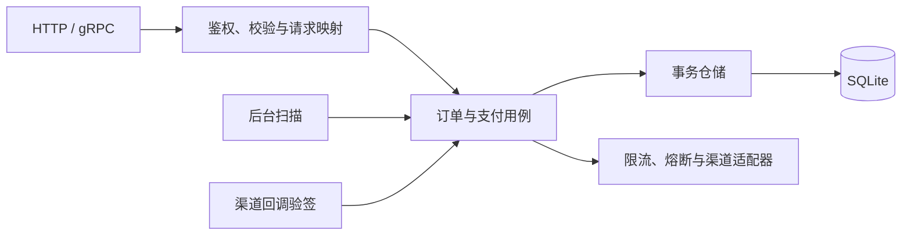

# 支付与订单服务架构

基于 Fino 和 SQLite，面向已签约授权代扣场景，提供订单管理、支付受理、结果确认和业务审计。API 以 `proto/` 为准；本文描述目标设计，当前本地实现及真实渠道边界见[验收记录](acceptance.md)。

## 1. 服务定位

服务接收商户订单和上游授权引用 `mandate_reference`，校验商户归属、授权有效性及渠道账户绑定后执行支付。金额统一为人民币分，每单全额支付，订单内容创建后不可修改。

采用单机、单活动进程部署，API、后台扫描和渠道回调共用领域逻辑。签约管理、收银台、退款、分账、多币种及拒付后更换付款方式留给后续业务扩展。

## 2. 架构与数据

遵循 Fino 分层：app 负责作用域、映射和错误处理，domain/service 承载业务规则，infra/repo 实现事务与约束。复用 finokit、gokit、gobreaker 和渠道官方 SDK。

| 模型 | 职责与约束 |
| --- | --- |
| Order | 保存不可变订单内容；商户订单号唯一，金额为 1～100000000 分 |
| Payment | 每单一个支付意图；保存固定金额快照、授权与账户引用、渠道结果和恢复进度 |
| AuditEvent | 追加记录业务变更、操作者、原因、关联请求和核查证据引用 |

商户订单号与订单 ID 分别保证订单创建和支付受理幂等。同订单号同内容返回已有订单，异参返回 `ORDER_CONFLICT`；同订单同授权返回已有支付，更换授权返回 `PAYMENT_CONFLICT`。并发唯一冲突后重读并执行相同判断。

数据库使用 WAL、FULL 同步、外键和有界锁等待，连接级参数覆盖全部连接。写池为 1，读池有界；写入在专用连接的短 `BEGIN IMMEDIATE` 事务中重读状态，网络请求在事务外执行。唯一约束、外键、CHECK、渠道引用部分唯一索引及审计追加触发器由迁移落实。[SQLite 事务说明](https://sqlite.org/lang_transaction.html)

服务端生成 UUIDv7，支付与审计不软删除。支付扫描使用 `(status, next_check_at)` 索引，事务中不转用其他连接写入，不叠加版本锁。

## 3. 支付流程

订单状态为 `PENDING_PAYMENT → PAID / CANCELLED`。支付保留四种状态：

| 状态 | 含义 |
| --- | --- |
| CREATED | 已持久受理，等待首次提交 |
| PENDING | 已准备提交，结果尚未确认 |
| SUCCEEDED | 渠道确认成功 |
| DECLINED | 已确定未支付且不可继续，包括明确拒付、提交前授权失效或本地撤销 |

**受理。** 校验授权并选择渠道账户，在事务内重读订单，固定支付金额、授权及账户，写入 CREATED、调度时间和审计。事务提交成功后才确认受理，支付记录直接作为后台待处理依据。

**提交。** 获得渠道配额并确认授权仍有效后，在短事务内重读订单和支付、检查核查标记及预算，改为 PENDING，固定首次提交时间和重试期限，预留调用轮次，再调用渠道。每轮恢复重试执行相同检查；事务失败或提交结果不确定时不发起调用。

**确认。** 提交结果、主动查询和回调进入同一确认用例，校验账户、交易标识、金额、CNY 和渠道引用。处理中结果也保存首次取得的渠道引用；成功时支付、订单与审计同事务更新。正常终态停止调度，重复同结果不再修改，矛盾结果进入核查。

**取消。** 无支付、明确拒付或可证明尚未提交的订单允许取消，存在未关闭核查时除外。撤销 CREATED 必须在事务内确认调用轮次为零、首次提交时间为空，同步取消订单、将支付置为 DECLINED、标记 `ORDER_CANCELLED` 并写审计。取消与首次提交通过事务内重读互斥；PENDING 不因超时直接取消。

## 4. 恢复与核查

### 自动恢复

后台使用 `time.Ticker` 有界扫描和并发执行，首次提交、查询和重试共用支付 ID 级在途去重。停机停止领取并有界等待在途操作，重启沿用原记录。未获配额的 CREATED 延后，PENDING 优先查询渠道；超时、暂无记录和查询失败都不等于拒付。

渠道适配器明确授权撤销、查询标识、结果终局性、一致性窗口，以及幂等保护期和可重试错误。每次提交显式使用 Payment.id 作为幂等键，并保持账户和请求参数不变。

首次提交前，以首次提交时间为起点，按渠道幂等保护期与服务恢复时长的较小值扣除安全余量，确定并保存重试截止时间。仅在期限内、预算未耗尽且渠道允许时重试同一操作；不支持安全重试的渠道只查询，并关闭 SDK 提交重试。缺少渠道查询标识不能当作交易不存在。

适配器统一管理重试，提交轮次与 SDK 每轮次数共同约束请求量，调用超时不能越过安全期限，不叠加其他 HTTP 重试。提交与查询计数、期限和参数跨重启保留，配置变更不能延长期限。查询预算耗尽后标记 `RECONCILIATION_REQUIRED`，告警并降为低频查询。

### 异常关闭

普通确认不能覆盖终态，也不能清除冲突或待补偿标记。矛盾结果或取消后收到可信成功时，同事务保留当前状态、标记 `CHANNEL_RESULT_CONFLICT`、安排低频核查，并追加 `PAYMENT_RESULT_CONFLICT` 审计。证据引用关联受控存储中的渠道结果、金额、交易号和时间；相同支付与证据不重复登记。

人工处理须有授权、操作者和证据引用，走领域核查用例：原状态正确则记录 `RECONCILIATION_CLOSED` 并清除标记；漏记成功则纠正支付，订单未取消时同步为 PAID。已取消订单保持取消并标记 `COMPENSATION_REQUIRED`，外部补偿完成、凭证留存后才关闭。其他矛盾保持核查至外部处置完成，不抹除已确认成功事实，不直接改 SQL 或另扣一笔。

冲突和待补偿的终态也参与低频核查。没有确定证据不关闭；关闭后清理正常终态调度。普通可信终态确认可以清除技术原因及 `RECONCILIATION_REQUIRED`，不能代替上述核查流程。

## 5. 访问与保护

商户身份来自认证上下文，所有资源检查归属，跨商户返回不存在。入口保护后先识别业务重放，仅新增业务进入写配额与积压准入。授权引用和原文不向普通查询接口回传。

| 层级 | 保护措施 |
| --- | --- |
| 入口 | 可信连接 IP、请求体大小、总并发；不信任客户端转发头 |
| 商户 | 读写独立配额，超限返回 HTTP 429 / gRPC ResourceExhausted |
| 渠道 | 账户级 QPS 与并发上限；提交、查询独立熔断，预留查询容量 |
| 数据库 | 有界写等待和积压阈值；故障返回 503 / Unavailable，不转为内存成功 |

本地限流限定键数、TTL 和突发量，入口总量保护覆盖重启或淘汰后的计数重置。业务拒付不计技术故障，网络超时由 context 和客户端控制，阈值依据渠道契约与压测确定。

回调使用原始报文经官方 SDK 验签，校验账户与时间窗口后调用确认用例，事务提交后再确认接收。只将成功或明确终局拒付映射为终态，重复投递记录访问日志，业务变化写审计。后续增加履约等外部副作用时，另行保证幂等投递。

业务变更与审计同事务。审计查询仅管理员可用且自身留审计；原因码由服务端脱敏定义，证据原文独立受控。凭证、支付要素及原始回调不落日志。SQLite 以文件权限、应用边界和追加触发器保护审计，独立不可变归档按需扩展。

## 6. 接口与交付边界

统一前缀 `/orderpay/v1`，保留六个 RPC：

| RPC | 相对 HTTP 路径 |
| --- | --- |
| CreateOrder | POST `/orders`，请求体为 OrderInput |
| GetOrder | GET `/orders/{order_id}` |
| ListOrders | GET `/orders` |
| CancelOrder | POST `/orders/{order_id}:cancel`，无请求体 |
| CreatePayment | POST `/orders/{order_id}/payments`，请求体为 PaymentInput |
| ListAuditEvents | GET `/admin/audit-events`，仅管理员 |

PaymentInput 仅含 mandateReference；订单详情聚合 OrderView 与可空 PaymentView，后者返回金额快照、状态、渠道引用和脱敏原因。分页使用 pageSize/pageToken、nextPageToken 和 `(create_time, id)` 排序，游标绑定商户及过滤条件。

新支付和非终态重放的 HTTP 目标为 202，Location 指向订单详情；终态重放为 200，需传输层实现。只有订单 PAID、支付 SUCCEEDED 且无未关闭核查时才可履约。错误与序列化遵循 Fino 协议。

本方案借鉴 [Vendure 的渠道处理器](https://github.com/vendurehq/vendure/blob/master/packages/core/src/config/payment/payment-method-handler.ts)、[Medusa 的支付快照](https://github.com/medusajs/medusa/blob/develop/packages/modules/payment/src/models/payment.ts)、[Stripe 的幂等重试](https://github.com/stripe/stripe-go#automatic-retries)及 [Kill Bill 的查询恢复](https://docs.killbill.io/latest/payment_plugin)，按当前范围保留必要机制。

本地代码已通过 Fino 生成，具体验收结果见[验收记录](acceptance.md)。实现阶段需启用 SQLite、验证迁移，并覆盖取消与提交竞争、扣款后落库失败、回调与重试竞争、矛盾终态、重试预算、人工核查及磁盘故障。使用本机持久卷和在线备份；恢复旧备份后先核对渠道账单，切换前隔离旧实例。监控写等待、WAL 与磁盘、待处理年龄、重试及核查积压。容量、恢复点和恢复耗时须经压测与演练验证，本方案不提供多机高可用。
