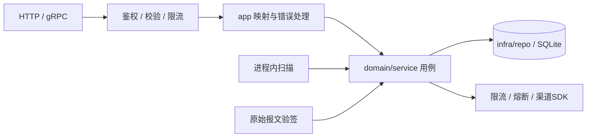

# 支付 / 订单服务架构（Fino + SQLite）

这是全新契约设计，不考虑旧API、字段编号或存量数据兼容。尚未实现后端；`proto/` 是API唯一事实来源。

## 1. 范围与结构

一个 `OrderpayService`，Go/Fino + 本机SQLite，单机单活动进程。API、支付扫描和渠道回调共用领域用例，无缓存、消息中间件或独立任务服务。

商户后端负责定价。金额统一为人民币分，每单全额支付一次；订单内容创建后不可修改，拒付后可取消，重新购买创建新订单。退款、库存、分账、多币种和自动补扣不在范围内。

遵循Fino现有分层，模型与API Input/View分离。复用finokit的SQLite适配、gokit本地限流器、gobreaker及渠道官方SDK，不开放业务模型的通用写入CRUD。

## 2. 三个模型

| 模型 | 约束 |
| --- | --- |
| `Order` | 唯一 `(merchant_id, merchant_order_no)`；金额1至100000000分；金额与描述不可变 |
| `Payment` | 唯一 `order_id`；与订单商户一致；账户内非空渠道流水唯一 |
| `AuditEvent` | 只追加：主体、动作、资源、前后状态、原因及request ID |

商户订单号保证订单创建幂等，订单ID保证支付受理幂等，不再设置请求幂等键或独立幂等表。同商户订单号、同金额与描述返回已有订单，内容不同返回ORDER_CONFLICT；重复支付返回唯一支付的当前状态，不再创建交易。并发唯一冲突后重读，执行同一规则。

金额和币种不在Payment重复存储，渠道调用从不可变订单读取金额并固定使用CNY。channel_account_id引用稳定的渠道账户配置，受理后不可切换；支付UUID为渠道交易标识。服务端生成UUIDv7，支付和审计不软删除。

proto声明唯一索引与 `(status, next_check_at)` 调度索引。外键、金额/状态CHECK、渠道流水部分唯一索引和审计禁止UPDATE/DELETE的触发器由后续迁移实现。SQLite使用WAL、FULL同步、外键和有界busy_timeout；写池为1、读池有界，连接级配置覆盖所有连接。所有写入使用专用连接上的短 `BEGIN IMMEDIATE` 事务，事务内重读状态；网络调用在事务外，不叠加版本锁。[WAL](https://sqlite.org/wal.html)、[事务](https://sqlite.org/lang_transaction.html)

## 3. 四个支付状态

订单状态为 `PENDING_PAYMENT → PAID / CANCELLED`。支付状态如下：

| 状态 | 行为 |
| --- | --- |
| CREATED | 已持久受理，等待首次提交 |
| PENDING | 已准备提交、结果待确认，只允许查询或接收回调 |
| SUCCEEDED | 渠道确认成功，订单同时改为PAID |
| DECLINED | 渠道明确终局拒付，允许取消订单 |

1. **受理**：同一事务检查订单、创建CREATED支付、设置next_check_at并写审计。支付记录本身就是持久待处理工作。
2. **提交**：取得配额及熔断放行后，在短事务中重读CREATED、改为PENDING、记录submitted_at及审计；提交后调用渠道一次。SDK及HTTP层关闭自动扣款重试。
3. **确认**：查询和回调共用确认用例，事务内校验渠道账户、交易标识、金额、币种、流水及当前状态；更新支付、订单与审计。成功须有流水，明确拒付可无流水；已确认的流水不能被替换。
4. **恢复**：到期PENDING只查询，不再提交。超时、渠道暂无记录和查询故障都不表示拒付。终态清空调度时间，重复同结果不再修改状态，矛盾结果告警并保留原终态。

只有无支付或DECLINED时可取消，CREATED和PENDING均阻止取消；取消、受理和确认通过相同写事务规则串行判定。首次提交前后崩溃可能留下无法确认的PENDING，需要人工核查，不能为了恢复而自动补扣。

扫描使用time.Ticker，有界取批、并发限制和在途集合去重。CREATED未获配额则持久化延后；PENDING按持久化check_attempts退避查询，达到阈值后告警并降为低频查询，业务状态仍为PENDING。无需另设UNKNOWN/REVIEW状态。重启不重置次数或submitted_at；停机停止领取并有界等待在途操作。

## 4. 认证、回调与保护

merchant_id只取已验证凭证，所有资源检查归属，跨商户返回不存在。鉴权、参数校验和入口限流后先查询业务唯一键，已有资源直接按幂等规则返回；仅新增业务执行写配额和积压准入。

回调适配器读取原始字节，使用官方SDK验签并检查账户与时间窗口，再调用确认用例，不开放结果写入RPC。仅成功或明确终局拒付可确认，处理中通知保持PENDING。依靠支付终态和事务内字段校验实现确认幂等，不另存回调收件表或摘要；成功提交后按渠道协议确认接收。重复同结果安全确认，异金额、异账户、异流水或矛盾终态告警；未知支付按渠道重试协议响应。审计记录业务变更，重复投递记录访问日志。

| 层级 | 保护 |
| --- | --- |
| 入口 | 可信连接IP、报文大小、总并发；不信任客户端转发头 |
| 商户 | 读写独立配额，超限HTTP429 / gRPC ResourceExhausted |
| 渠道 | 账户级QPS与并发上限；提交/查询分别熔断，查询预留容量 |
| SQLite | 单写池、有界等待、积压阈值；故障返回503 / Unavailable，不转为内存成功 |

令牌桶复用gokit并限制键数、TTL与突发量，重启或淘汰重置计数由入口总配额兜底。熔断复用gobreaker，业务拒付不计技术失败；网络超时由context与HTTP客户端控制。阈值通过渠道配额和压测确定。已受理支付遇到异常仍保留记录。[熔断组件](https://github.com/sony/gobreaker)

业务变更和审计同事务；访问日志不替代业务审计。审计查询仅管理员可用，查询本身留审计。凭证、支付要素与原始回调不落日志。SQLite以文件权限、应用边界和追加触发器保护审计，独立不可变归档按需扩展。

## 5. 六个RPC

统一前缀 `/orderpay/v1`，只返回业务View。订单详情同时返回可空PaymentView；列表仅返回订单摘要。分页使用pageSize/pageToken与nextPageToken，按 `(create_time, id)` 确定排序，token绑定商户和过滤条件。

| RPC | 相对HTTP路径 |
| --- | --- |
| CreateOrder | POST `/orders` |
| GetOrder | GET `/orders/{order_id}` |
| ListOrders | GET `/orders` |
| CancelOrder | POST `/orders/{order_id}:cancel` |
| CreatePayment | POST `/orders/{order_id}/payments` |
| ListAuditEvents | GET `/admin/audit-events`，仅管理员 |

CreateOrder的HTTP请求体直接为OrderInput；gRPC使用CreateOrderRequest.order。取消和支付的请求只含路径中的order_id，无额外请求体。新支付及未完成重放目标为202，Location指向订单详情，终态重放200；需后续传输实现，HTTP注解本身不生成状态码。只有SUCCEEDED/PAID可以驱动履约，错误和序列化遵循Fino既有协议。

## 6. 实现验收

本次只更新文档和proto，不运行fino build或修改生成产物。后续设置fino.yaml的SQLite数据库，验证迁移及以下场景：重复订单与异参、并发支付、取消竞态、调用前后崩溃、重启只查询不补扣、重复及矛盾回调、审计失败回滚、锁忙和磁盘满。

SQLite必须使用本机持久卷和在线备份。恢复旧备份后先核对渠道账单再恢复提交，切换前隔离旧实例。监控写等待、磁盘/WAL、最老未完成支付及持续待确认告警；按投递事件逐条归档回调不在本期范围。
