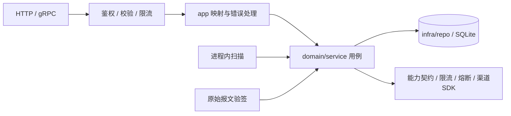

# 支付 / 订单服务架构（Fino + SQLite）

本方案为全新契约，不考虑旧兼容。保留三个模型、六个RPC、四个支付状态，尚未实现后端；proto是API唯一事实来源。

## 1. 范围与结构

一个OrderpayService，Go/Fino + 本机SQLite，单机单活动进程。API、支付扫描和渠道回调共用领域用例，无缓存、消息中间件或独立任务服务。

本期仅支持**上游已签约授权代扣**：商户提供mandate_reference，本服务校验授权归属、有效性及渠道账户绑定，不自行管理签约或保存凭证原文。商户后端负责定价，金额统一人民币分，每单全额支付。扫码、托管收银台、退款、分账、多币种和拒付后更换付款方式另行设计。

遵循Fino分层，模型与Input/View分离。复用finokit的SQLite适配、gokit限流器、gobreaker及渠道官方SDK，不开放业务模型的通用写入CRUD。

## 2. 三个模型与事务

| 模型 | 职责与约束 |
| --- | --- |
| Order | 唯一 `(merchant_id, merchant_order_no)`；金额1至100000000分，内容创建后不可改 |
| Payment | 每单一个支付意图；固定金额快照、授权引用和渠道账户；保存渠道引用及恢复进度 |
| AuditEvent | 只追加业务变更、主体、资源、前后状态、脱敏原因和request ID |

订单号保证创建幂等：同商户、同订单号、同内容返回现有订单，异参返回ORDER_CONFLICT。订单ID保证支付幂等：同授权重放返回现有支付，更换授权返回PAYMENT_CONFLICT。首次受理时校验上游授权并选择账户，在写事务内重读订单，复制金额快照并固定参数。渠道重试始终使用该快照，不能重新选择账户或修改请求参数。

proto声明业务唯一索引及 `(status, next_check_at)` 扫描索引。外键、CHECK、账户内渠道引用唯一索引及审计追加触发器由后续迁移落实。服务端生成UUIDv7，不软删除支付与审计。

SQLite使用WAL、FULL同步、外键及有界busy_timeout；写池为1、读池有界，连接级参数覆盖全部连接。所有写入在专用连接的短BEGIN IMMEDIATE事务中重读状态，网络调用在事务外，不叠加版本锁。[SQLite事务](https://sqlite.org/lang_transaction.html)

## 3. 四个状态与恢复

订单为 `PENDING_PAYMENT → PAID / CANCELLED`；只有无支付或明确拒付时可取消。支付如下：

| 状态 | 含义 |
| --- | --- |
| CREATED | 已受理，尚未准备提交，等待配额 |
| PENDING | 已准备提交，结果未确认；查询为主，按渠道能力决定是否允许同操作重试 |
| SUCCEEDED | 渠道确认成功，订单同事务改为PAID |
| DECLINED | 已确定未支付且不可继续；包括渠道终局拒付或首次提交前授权明确失效 |

1. **受理**：支付CREATED、金额快照、到期时间和审计同事务写入，提交后才确认受理。支付记录本身是持久待处理工作。
2. **提交**：取得配额、首次提交前确认授权仍有效；短事务重读状态，改为PENDING、固定submitted_at与retry_deadline_at、预留submit_attempts，再调用渠道。额度不足或依赖故障延后，不伪装成已提交或业务拒付。
3. **确认**：提交结果、查询和回调共用确认用例。校验账户、交易标识、快照金额、CNY和渠道引用；PENDING结果也保存首次获得的渠道引用。成功时支付、订单和审计同事务更新；终态清空调度时间，重复同结果不再修改，矛盾结果告警。
4. **恢复**：PENDING优先按渠道引用或原商户交易号查询。超时、暂无记录和查询错误都不表示拒付；无法定位渠道对象时，只能在下面的安全重试条件内幂等重放，不能把缺少查询标识当作交易不存在。

渠道适配器必须明确以下能力，不默认所有渠道等价：

| 能力 | 必须约定 |
| --- | --- |
| 授权 | 引用归属、有效性、绑定账户及撤销语义 |
| 提交 | 显式传Payment.id作为幂等键；同键同参数重试，不能依赖SDK每次自动生成新键 |
| 查询 | 可用标识、处理中/暂无记录含义、一致性窗口及终局状态 |
| 重试 | 是否保证幂等、保护期和允许重试的技术错误；不支持时禁止再次提交 |

首次提交前，以submitted_at加渠道保证时长与本服务恢复时长的较小值、扣安全余量，持久化retry_deadline_at；不支持安全重试时留空，并关闭SDK内部提交重试。仅技术错误或符合渠道契约的无交易结果可在截止时间内重试，且未超过提交轮次预算；明确拒付不重试。期限、轮次、参数均不因重启重置，配置变更不能延长既有期限。

重试统一封装在适配器：可复用SDK有界重试，后台记录每轮调用；轮次上限和SDK每轮上限共同限制请求数量，不再叠加另一套HTTP重试。每轮调用及内部重试的超时预算不得跨越安全截止时间。条件不足时只查询并转人工核查，禁止换键、换账户重新扣款。相同操作的技术重试不创建新的支付尝试；本期拒付后重新购买仍需新订单。

扫描使用time.Ticker，有界取批、并发限制和在途去重。未获配额的CREATED延后；PENDING按持久化check_attempts退避查询，预算耗尽则设置RECONCILIATION_REQUIRED、告警并降为低频查询，状态仍为PENDING。停机停止领取并有界等待，重启恢复原记录。

## 4. 回调、限流与审计

商户身份只取已验证凭证，所有资源检查归属，跨商户返回不存在。鉴权、校验及入口限流后先识别业务重放，仅新增业务进入写配额与积压准入。授权原文及引用不对普通查询接口回传。

回调读取原始字节，官方SDK验签并校验账户与时间窗口，再调用确认用例。通过事务内字段校验和终态规则保证确认幂等，无独立回调表或结果写入RPC。只确认成功及明确终局拒付，处理中通知保持PENDING；提交后才确认接收。重复投递走访问日志，业务变更写审计；增加发货等外部副作用时需另行设计幂等投递。

| 层级 | 保护 |
| --- | --- |
| 入口 | 可信连接IP、请求体大小、总并发，不信任客户端转发头 |
| 商户 | 读写独立配额；超限HTTP429 / gRPC ResourceExhausted |
| 渠道 | 账户级QPS与并发上限、提交/查询独立熔断，查询预留容量 |
| SQLite | 单写池、有界等待与积压阈值；故障返回503 / Unavailable，不转内存成功 |

限流器限制键数、TTL与突发量，重启或淘汰导致的计数重置由入口总量兜底。业务拒付不计熔断技术故障；网络超时使用context及HTTP客户端控制。容量和预算通过压测与渠道契约确定。

reason_code采用服务端定义的脱敏值，例如NETWORK_ERROR、GATEWAY_PROCESSING、AUTHORIZATION_INVALID、PAYMENT_DECLINED、RECONCILIATION_REQUIRED；不透传渠道原始错误。可信终态确认会替换待确认原因。人工核查先查询渠道、核对交易号及金额，记录证据引用和操作者，再经受控运维入口调用相同确认用例；不直接改SQL，不据此另扣一笔。暂不能确定则保持PENDING。

业务状态与审计同事务；审计查询仅管理员可用且自身留审计。凭证、支付要素和原始回调不落日志。SQLite以文件权限、应用边界及追加触发器保护，独立不可变归档按需扩展。

## 5. 六个RPC

统一前缀 `/orderpay/v1`。订单详情返回OrderView及可空PaymentView，列表只返回订单；PaymentView包含快照金额、状态、渠道引用与脱敏原因，不暴露授权或后台调度字段。分页使用pageSize/pageToken、nextPageToken与 `(create_time, id)` 稳定排序，token绑定商户及过滤条件。

| RPC | 相对HTTP路径 |
| --- | --- |
| CreateOrder | POST `/orders`，body为OrderInput |
| GetOrder | GET `/orders/{order_id}` |
| ListOrders | GET `/orders` |
| CancelOrder | POST `/orders/{order_id}:cancel`，无body |
| CreatePayment | POST `/orders/{order_id}/payments`，body为PaymentInput |
| ListAuditEvents | GET `/admin/audit-events`，仅管理员 |

PaymentInput仅包含mandateReference，gRPC通过CreatePaymentRequest.payment传入。新支付及非终态重放的HTTP目标为202，Location指向订单详情；终态重放200，需后续传输实现。只有SUCCEEDED/PAID可驱动履约，错误和序列化遵循Fino既有协议。

## 6. 依据与验收

借鉴[Vendure渠道处理器](https://github.com/vendurehq/vendure/blob/master/packages/core/src/config/payment/payment-method-handler.ts)的支付授权输入、[Medusa支付模型](https://github.com/medusajs/medusa/blob/develop/packages/modules/payment/src/models/payment.ts)的金额快照、[Stripe SDK](https://github.com/stripe/stripe-go#automatic-retries)的幂等重试及[Kill Bill](https://docs.killbill.io/latest/payment_plugin)的查询恢复；保留当前单实例范围，不复制会话、Attempt或通用工作流框架。

本次仅维护文档和proto，不运行fino build或修改生成产物。后续启用fino.yaml的SQLite并验证迁移。验收覆盖：授权越权/撤销、重放时更换授权、并发受理与取消、金额快照、渠道调用前后崩溃、原键重试及预算、期限跨重启不延长、重复/矛盾回调、人工核查留审计、磁盘满和锁忙。

使用本机持久卷与在线备份；恢复旧备份后先核对渠道账单再恢复提交，切换前隔离旧实例。监控写等待、磁盘/WAL、最老未完成记录、重试量及RECONCILIATION_REQUIRED积压。
