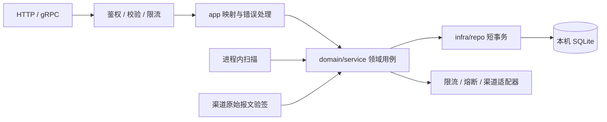
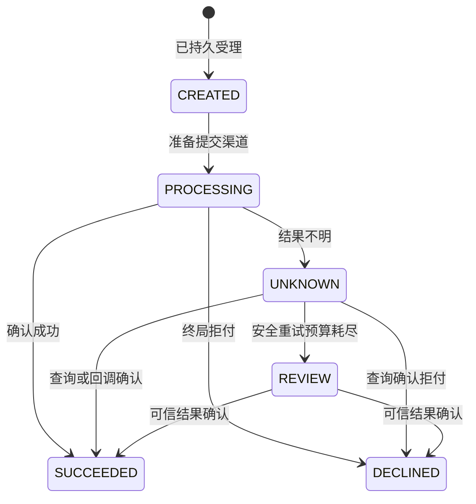

# 支付 / 订单服务架构（Fino + SQLite）

本文定义契约与实现边界，尚未实现后端。`proto/` 是 API 唯一事实来源；本次仅维护文档与 proto，不生成代码。

## 1. 边界与结构

一个 `OrderpayService` 对应 `orderpay-server`，采用 Go/Fino + SQLite，单机单活动进程，API、支付执行与对账扫描共用领域逻辑。不引入缓存、消息中间件或独立任务服务。

面向可信商户后端，商户负责定价；本期仅支持 CNY、整数分、全额支付，每个订单只有一笔支付。拒付后可取消，重新购买创建新订单。退款、库存、分账和收银台交互不在本期范围。

遵循 Fino 分层：proto 定义模型和独立的 Input/View；app 处理作用域、映射与响应，domain/service 管理状态与工作流，infra/repo 实现事务。通用认证和限流放 endpoint middleware，HTTP/gRPC共享策略。复用 finokit 的 SQLite 适配、gokit 本地限流器、gobreaker及渠道官方SDK，不自行实现通用框架。

## 2. 数据与事务

| 模型 | 必要约束 |
| --- | --- |
| `Order` | 唯一 `(merchant_id, merchant_order_no)`；金额1至100000000分，币种CNY |
| `Payment` | 唯一 `order_id`；订单归属、金额币种一致；账户内非空渠道流水唯一 |
| `IdempotencyRecord` | 唯一 `(merchant_id, operation, key_digest)`；保存请求摘要及资源引用 |
| `CallbackReceipt` | 唯一 `(channel, channel_account_id, event_id)`；保存支付关联及报文摘要 |
| `AuditEvent` | 仅追加，记录主体、动作、资源、前后状态、原因和request ID |

proto 显式声明复合唯一索引和 `(status, next_check_at)` 调度索引。外键、CHECK、渠道流水部分唯一索引及审计拒绝UPDATE/DELETE的触发器仍需后续迁移实现，不能以proto编译通过代替迁移验证。模型不开放通用写入CRUD；服务端生成UUIDv7，不软删除支付、幂等和审计记录。

SQLite建议配置WAL、`synchronous=FULL`、`foreign_keys=ON`、`busy_timeout=1000`，连接级配置需覆盖所有连接。写池限制为1，读池有界；业务写入在专用连接中使用短 `BEGIN IMMEDIATE` 事务，重读状态后更新，网络调用在事务外。禁止在事务内转用其他连接写入，避免单写池自锁。SQLite同时仅有一个写事务，WAL不能用于跨主机共享文件。[WAL](https://sqlite.org/wal.html)、[事务](https://sqlite.org/lang_transaction.html)、[PRAGMA](https://sqlite.org/pragma.html)

## 3. 支付与恢复

订单为 `PENDING_PAYMENT → PAID / CANCELLED`。支付为：

1. **受理**：同一事务校验订单并创建支付、幂等记录和审计，设置CREATED及到期调度时间；提交后才确认受理。支付记录本身就是持久待处理工作，无需另建任务队列。
2. **执行**：扫描器领取到期CREATED，在途集合去重；检查渠道配额后，以短事务条件更新为PROCESSING、写入首次提交时间和审计，再调用渠道。渠道幂等键固定为支付UUID。
3. **确认**：回调与查询走同一领域用例。成功时支付SUCCEEDED、订单PAID及审计同事务提交；终态清空调度时间。使用version条件更新并在冲突后重读，迟到失败不能覆盖成功。
4. **恢复**：重启后PROCESSING先查渠道，不重新当作首次提交。超时、查询失败和不合法回执保持UNKNOWN，持久化次数与下次查询时间；超过累计预算进入REVIEW，保留低频查询和告警。

只有无支付记录或明确拒付的订单可取消；CREATED也阻止取消。取消与受理在相同写事务边界重读订单，避免先校验后写入的竞态。互相矛盾的终局结果只记录异常并告警，不静默翻转终态。

扫描使用标准库 `time.Ticker`，不需要日历调度器。单个扫描循环按 `(next_check_at, id)` 有界取批、限制并发、跳过在途记录；进程关闭时停止领取并等待在途操作。处理失败后的下一次调度必须持久化，重启不能重置次数、首次提交时间或累计预算。

查询退避可从5秒增长至5分钟并加入抖动。自动补发仅在渠道可靠幂等、保护期未过、明确无交易且一致性等待窗口已过时使用原键；普通404不满足条件。否则进入REVIEW，禁止自动换键、换渠道重扣。`ReconcilePayment` 仅在允许的冷却时间后提前安排查询，不重置预算、不强行放行在途任务；CREATED保留原提交计划，终态直接返回，REVIEW仅查询。

## 4. 幂等、隔离与回调

商户身份只取已认证上下文，所有资源访问检查merchant_id；跨商户返回不存在。显式 `idempotency_key` 在HTTP JSON中为idempotencyKey，HTTP/gRPC使用同一规则。同键同参返回当前资源，同键异参报冲突；业务订单号重复也比较规范化内容。并发唯一约束冲突须重读并区分重放、异参和已有支付，不能全部当数据库故障。幂等记录与业务资源一起保留。

渠道回调读取原始字节，使用官方SDK验签并核对渠道账户、时间窗口、支付、金额币种和流水，然后直接调用领域用例，不另声明“可信结果写入”RPC。报文摘要仅供追溯，不能代替验签。原始回调路由由渠道适配器维护，不能用通用JSON解码重建待验签报文。

回调去重、状态更新和审计同事务，提交后才确认接收。同事件同支付同摘要返回成功；同事件异内容告警并拒绝覆盖。若渠道没有稳定事件ID，适配器必须定义稳定去重规则。未知支付不确认业务成功，按渠道重试协议响应并告警。

## 5. 限流、降级与审计

| 层级 | 策略 | 行为 |
| --- | --- | --- |
| 入口 | 可信连接IP、请求体大小和总并发 | 拒绝未授权滥用，不能直接信任转发头 |
| 商户 | 创建、支付、读取、人工对账分别限流 | HTTP429 / gRPC ResourceExhausted，轮询不挤占支付预算 |
| 渠道 | 账户级QPS和并发限制，查询预留独立容量 | 尚未提交的支付延后，积压过大时拒绝新受理 |
| SQLite | 单写池、有界等待和积压阈值 | 锁忙、磁盘满或审计失败返回503 / Unavailable，不降级为内存成功 |

本地令牌桶复用 `gokit/middleware/ratelimit`，明确有界键数量、TTL和突发量；重启或LRU淘汰可能重置配额，入口总量限制兜底。具体容量由压测确定，不把平均速率写成严格时间窗承诺。

熔断复用 `sony/gobreaker/v2`，提交与查询分开，业务拒付不计技术失败。调用超时使用context与HTTP客户端超时；gobreaker的Timeout是熔断打开时长。受理前不可用可拒绝，受理后异常保留支付；CREATED延后，UNKNOWN继续安全查询，不能伪造成功或将超时当拒付。[组件说明](https://github.com/sony/gobreaker)

业务状态和审计同事务。访问日志独立记录401/429/503，不替代业务审计；凭证、支付要素和原始回调不落日志。管理员审计查询有独立权限，查询动作自身留审计。SQLite无数据库角色授权，依赖文件权限、应用边界及追加触发器；文件管理员仍能篡改，独立不可变归档按需扩展。

## 6. API与验收边界

统一路径前缀 `/orderpay/v1`，API只返回业务View，后台next_check_at留在模型内部。分页使用pageSize/pageToken与nextPageToken，确定排序，token绑定商户及过滤条件；订单使用 `(create_time, id)`，审计使用 `(create_time, id)`，不假设UUID生成顺序等于事务提交顺序。

| RPC | 相对HTTP路径 |
| --- | --- |
| CreateOrder | POST `/orders` |
| GetOrder / ListOrders | GET `/orders/{order_id}` / `/orders` |
| CancelOrder | POST `/orders/{order_id}:cancel` |
| CreatePayment | POST `/orders/{order_id}/payments` |
| GetPayment | GET `/payments/{payment_id}` |
| ReconcilePayment | POST `/payments/{payment_id}:reconcile` |
| ListAuditEvents | GET `/admin/audit-events`，仅管理员 |

受理不等于成功，只有SUCCEEDED/PAID可驱动履约。新支付受理及非终态重放的HTTP目标为202并附Location/Retry-After，终态重放200；该行为需要后续传输实现，HTTP注解不自动生成状态码。gRPC正常返回PaymentView，调用方检查状态。业务错误遵循Fino错误定义及协议映射，序列化遵循实际编解码器。

本次移除草案中的HandlePaymentNotification RPC及消息，验签后改为进程内调用；PaymentView移除next_check_at，保留原字段编号7和名称为reserved，其余编号和枚举数值不变。这是契约收敛，已有调用方需同步适配。

后续实现前需设置 `fino.yaml` 的SQLite数据库并验证迁移。本次只检查proto编译和文档一致性，不运行fino build、不更改生成产物。上线验收至少覆盖：并发幂等、取消竞态、扣款后崩溃、重启恢复、重复与冲突回调、手动对账不绕过预算、审计失败回滚、磁盘满和锁忙、渠道保护期届满。

使用SQLite在线备份，不只复制运行中的.db；监控写等待、WAL、磁盘、最老待处理记录和UNKNOWN/REVIEW积压。恢复旧备份时先禁止提交扣款，结合渠道账单核对缺失记录后恢复；切换前先隔离旧实例，确保唯一活动进程。
