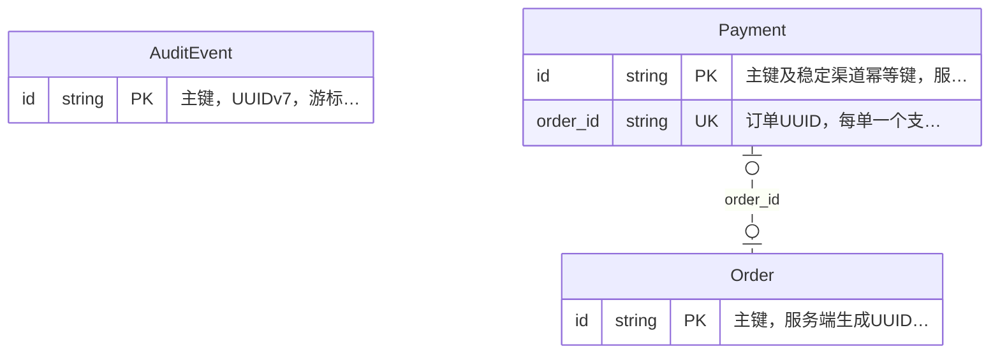

<!-- Code generated by fino. DO NOT EDIT. -->

# 模型 ER 图

模型和字段来自 proto；`.fino/er.yaml` 补充绘图配置与显式关系。图中按“字段名、类型、键、说明”展示，字段语义以详情表和 proto 为准。支持 `fino build --targets=api` 或 `protoc --er_out=docs`。

- 连线仅描述逻辑引用及数量上限：标量至多引用一个对象，集合可引用多个对象。图中不区分业务必需或可选，也不据此声明 SQL 可空性。符合命名和类型规则的推断也绘制逻辑连线，候选来源见关系表。
- 虚线表示非标识关系，实线表示来源字段构成默认主键的标识关系；声明与推断的来源见关系表。`JSON` 标签表示值对象或数组中的逻辑引用。
- 本文不创建数据库外键或业务校验。类型、索引与 NULL 为 proto 标注；`PK` 按默认 `id` 约定展示，实际表名、SQL 类型及约束以服务配置和数据库为准。

## 关系概览

| 来源字段 | 目标字段 | 形式 | 来源 |
|---|---|---|---|
| `orderpay.Payment.order_id` | `orderpay.Order.id` | 字段引用 | 命名推断（候选） |

## 关联诊断

- orderpay.AuditEvent.merchant_id：目标模型缺失或存在歧义，未建立关联
- orderpay.AuditEvent.actor_id：目标模型缺失或存在歧义，未建立关联
- orderpay.AuditEvent.resource_id：目标模型缺失或存在歧义，未建立关联
- orderpay.AuditEvent.request_id：目标模型缺失或存在歧义，未建立关联
- orderpay.Order.merchant_id：目标模型缺失或存在歧义，未建立关联
- orderpay.Payment.merchant_id：目标模型缺失或存在歧义，未建立关联
- orderpay.Payment.channel_account_id：目标模型缺失或存在歧义，未建立关联

## 模型详情

### `orderpay.AuditEvent`

来源：[orderpay/audit.proto](../proto/orderpay/audit.proto)

| 字段 | 模型类型 | DB 标注 | 说明 |
|---|---|---|---|
| `id` | `string` | PK（默认约定）；长度 36 | 主键，UUIDv7，游标及归档去重标识 |
| `merchant_id` | `string` | 长度 36 | 资源所属商户 UUID，系统事件可为空 |
| `actor_id` | `string` | 长度 128 | 已认证操作者或系统主体标识 |
| `action` | `string` | 长度 64 | 业务操作名称 |
| `resource_id` | `string` | 长度 36 | 业务资源 UUID |
| `request_id` | `string` | 长度 128 | 服务端请求关联标识 |
| `before_status` | `string` | 长度 64 | 变更前状态名称 |
| `after_status` | `string` | 长度 64 | 变更后状态名称 |
| `reason_code` | `string` | 长度 64 | 脱敏原因码，不保存凭证或原始报文 |
| `evidence_reference` | `string` | 长度 512 | 受控核查证据或工单引用，普通业务事件可为空，人工纠正及核查关闭时必填 |
| `create_time` | `timestamp` |  | 创建时间，UTC |

### `orderpay.Order`

来源：[orderpay/order.proto](../proto/orderpay/order.proto)

| 字段 | 模型类型 | DB 标注 | 说明 |
|---|---|---|---|
| `id` | `string` | PK（默认约定）；长度 36 | 主键，服务端生成UUIDv7 |
| `merchant_id` | `string` | 长度 36；唯一索引 `idx_order_merchant_no` | 已认证商户UUID |
| `merchant_order_no` | `string` | 长度 128；唯一索引 `idx_order_merchant_no` | 商户业务订单号，同时作为创建幂等标识 |
| `amount_minor` | `int64` |  | 人民币分，范围1至100000000，创建后不可变 |
| `description` | `string` | 长度 200 | 订单描述，创建后不可变 |
| `status` | `orderpay.OrderStatus` |  | 订单状态，仅领域用例可修改 |
| `create_time` | `timestamp` |  | 创建时间，UTC |
| `update_time` | `timestamp` |  | 最后更新时间，UTC |

### `orderpay.Payment`

来源：[orderpay/payment.proto](../proto/orderpay/payment.proto)

| 字段 | 模型类型 | DB 标注 | 说明 |
|---|---|---|---|
| `id` | `string` | PK（默认约定）；长度 36 | 主键及稳定渠道幂等键，服务端生成UUIDv7 |
| `merchant_id` | `string` | 长度 36 | 订单所属商户UUID |
| `order_id` | `string` | 长度 36；唯一索引 `idx_payment_order` | 订单UUID，每单一个支付意图 |
| `amount_minor` | `int64` |  | 受理金额快照，人民币分，受理后不可修改 |
| `mandate_reference` | `string` | 长度 128 | 上游已签约授权的不可变引用，不保存授权凭证原文 |
| `channel_account_id` | `string` | 长度 128 | 已与授权绑定的不可变渠道账户配置引用 |
| `status` | `orderpay.PaymentStatus` | 索引 `idx_payment_due` | 支付状态，技术异常保持待确认 |
| `provider_reference` | `string` | 长度 200 | 稳定渠道支付对象标识，无独立对象时使用流水号，首次取得后不可替换 |
| `reason_code` | `string` | 长度 64 | 服务端脱敏原因码，含待核查、终态冲突或待补偿标记，不能由普通确认清除 |
| `submitted_at` | `timestamp` | 允许 NULL | 首次准备提交时间，重启不重置 |
| `retry_deadline_at` | `timestamp` | 允许 NULL | 首次提交前确定的保守幂等重试截止时间，空值禁止再次提交 |
| `submit_attempts` | `int32` |  | 已预留的提交调用轮次，调用渠道前递增，重启不重置 |
| `next_check_at` | `timestamp` | 允许 NULL；索引 `idx_payment_due` | 下一次提交或查询时间，正常终态为空，异常终态安排低频核查 |
| `check_attempts` | `int32` |  | 累计查询次数，用于退避和核查告警，重启不重置 |
| `create_time` | `timestamp` |  | 创建时间，UTC |
| `update_time` | `timestamp` |  | 最后更新时间，UTC |

## 枚举与 JSON 值对象

以下值对象嵌入模型字段，不是独立数据库表。

### `orderpay.OrderStatus`

| 枚举值 | 数值 | 说明 |
|---|---|---|
| `ORDER_STATUS_UNSPECIFIED` | 0 |  |
| `ORDER_STATUS_PENDING_PAYMENT` | 1 |  |
| `ORDER_STATUS_PAID` | 2 |  |
| `ORDER_STATUS_CANCELLED` | 3 |  |

### `orderpay.PaymentStatus`

| 枚举值 | 数值 | 说明 |
|---|---|---|
| `PAYMENT_STATUS_UNSPECIFIED` | 0 |  |
| `PAYMENT_STATUS_CREATED` | 1 |  |
| `PAYMENT_STATUS_PENDING` | 2 |  |
| `PAYMENT_STATUS_SUCCEEDED` | 3 |  |
| `PAYMENT_STATUS_DECLINED` | 4 |  |

